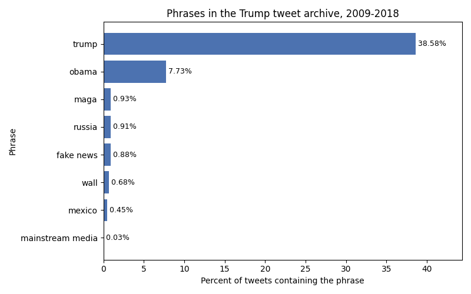

# [lab-web-data](https://csci40.rtealwitter.com/topics/05_web_scraping/lab.html)

## Catalog phrases in the Trump tweet archive

Percent of the archived tweets that contain each term/phrase, ignoring capitalization.

| phrase            | percent of tweets |
| ----------------- | ----------------- |
|         fake news | 00.88             |
|              maga | 00.93             |
|  mainstream media | 00.03             |
|            mexico | 00.45             |
|             obama | 07.73             |
|            russia | 00.91             |
|             trump | 38.58             |
|              wall | 00.68             |

Trump appears in far more tweets than any other phrase, followed by Obama. I had originally predicted MAGA would be the most common term.
